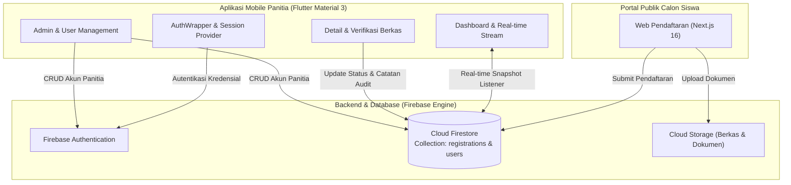
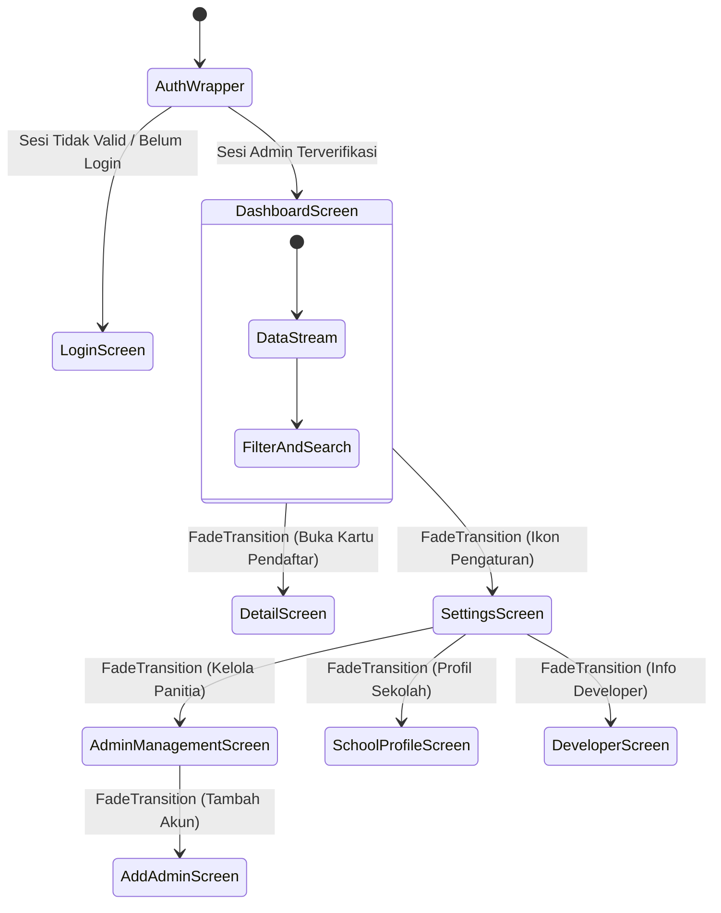

# PPDB Admin Mobile — SMK Bani Masum

<p align="center">
  
</p>

<p align="center">
  <strong>Aplikasi Manajemen Penerimaan Peserta Didik Baru (PPDB) Terintegrasi Real-Time</strong><br>
  Dirancang khusus untuk Panitia PPDB SMK Bani Masum guna verifikasi data, monitoring statistik pendaftar, dan manajemen status seleksi secara mobile.
</p>

<p align="center">
  
  
  
  
  
  
</p>

---

## 📑 Daftar Isi
- [Ikhtisar Sistem](#-ikhtisar-sistem)
- [Arsitektur & Diagram Alur](#-arsitektur--diagram-alur)
- [Fitur Utama](#-fitur-utama)
- [Teknologi & Dependensi](#-teknologi--dependensi)
- [Struktur Direktori Proyek](#-struktur-direktori-proyek)
- [Panduan Instalasi & Menjalankan](#-panduan-instalasi--menjalankan)
- [Konfigurasi Firebase & Keamanan](#-konfigurasi-firebase--keamanan)
- [Spesifikasi Build Platform](#-spesifikasi-build-platform)
  - [iOS (Swift Package Manager)](#ios-swift-package-manager-migrated)
  - [Android](#android)
- [Desain Sistem & UI/UX](#-desain-sistem--uiux)
- [Profil Pengembang](#-profil-pengembang)

---

## 🔭 Ikhtisar Sistem

**PPDB Admin Mobile** adalah aplikasi administratif mobile yang bekerja berdampingan dengan portal pendaftaran publik berbasis **Next.js 16**. Aplikasi ini memungkinkan panitia PPDB:
- Memantau arus pendaftaran secara real-time langsung dari perangkat Android atau iOS.
- Memverifikasi kelengkapan berkas identitas, rapor, dan ijazah calon siswa.
- Mengubah status verifikasi secara instan dengan sinkronisasi atomik ke Cloud Firestore.
- Menghubungi calon siswa atau orang tua/wali melalui integrasi WhatsApp & telepon langsung.
- Mengelola akun panitia/admin dengan kontrol hak akses berbasis peran (*Role-Based Access Control*).

---

## 🏗 Arsitektur & Diagram Alur

Sistem dibangun di atas arsitektur *event-driven* yang tersinkronisasi langsung melalui Firebase Cloud Firestore.



### Alur Navigasi & Transisi Aplikasi

Aplikasi mengimplementasikan sistem transisi berbasis `PageRouteBuilder` dengan kurva opasitas `FadeTransition` pada seluruh rute navigasi untuk pengalaman pengguna yang halus dan konsisten:



---

## 🚀 Fitur Utama

### 1. Autentikasi & Validasi Sesi
- **Multi-Role Authentication**: Mendukung peran Super Admin dan Panitia Verifikator.
- **Auto Session Rehydration**: Sesi tersimpan aman, mencegah *unauthorized access* dengan *listener* status auth reaktif via Provider.

### 2. Dashboard Pendaftaran Real-Time
- **Live Firestore Streaming**: Data statistik langsung terupdate tanpa perlu *refresh* manual.
- **Widget Metrik Cepat**: Total pendaftar, jumlah yang lulus verifikasi, menunggu antrean, berkas perlu perbaikan, dan ditolak.
- **Pencarian Cepat Multi-Kriteria**: Cari berdasarkan Nama, Nomor Registrasi, NISN, atau Asal Sekolah.
- **Filter Fleksibel**: Filter berdasarkan Status Seleksi dan Pilihan Program Keahlian (TKJ, TBSM, dll.).

### 3. Verifikasi & Manajemen Dokumen
- Tinjau biodata lengkap calon siswa dan data orang tua/wali.
- Periksa kelengkapan berkas fisik & digital yang diunggah.
- Ubah status seleksi dengan 1-tap:
  - `Menunggu verifikasi`
  - `Lulus verifikasi`
  - `Berkas tidak lengkap / dikembalikan`
  - `Tidak lulus verifikasi`
- Tombol kontak instan ke WhatsApp & Telepon calon peserta didik.

### 4. Manajemen Akun Panitia
- Daftar panitia yang memiliki hak akses sistem.
- Pembuatan akun panitia baru langsung dari aplikasi dengan hashing kredensial aman di Firebase Auth.

### 5. Diagnostik & Pengaturan
- Pantau latensi koneksi ke server database Firebase.
- Pengaturan notifikasi internal dan preferensi audit log.
- Dokumentasi profil sekolah dan arsitektur pengembang terintegrasi.

---

## 🛠 Teknologi & Dependensi

| Kategori | Teknologi | Deskripsi / Penggunaan |
| :--- | :--- | :--- |
| **Framework** | Flutter 3.x (Dart 3.x) | UI Toolkit multi-platform dengan Impeller rendering engine |
| **State Management** | `provider: ^6.1.2` | Manajemen state terpusat untuk sesi autentikasi dan status aplikasi |
| **Cloud Backend** | `firebase_core: ^3.15.2` | Inisialisasi platform Firebase |
| **Autentikasi** | `firebase_auth: ^5.3.4` | Otentikasi panitia berbasis token aman |
| **Database** | `cloud_firestore: ^5.6.0` | Database NoSQL real-time terdistribusi dengan offline persistence |
| **Komunikasi** | `url_launcher: ^6.3.3` | Eksekusi tautan eksternal (WhatsApp API, Panggilan Telepon, Web) |
| **iOS Engine** | Swift Package Manager | Pengganti CocoaPods, build native lebih cepat dan terisolasi |

---

## 📁 Struktur Direktori Proyek

```text
ppdb-admin/
├── android/                         # Konfigurasi native Android (Gradle Kotlin DSL)
├── assets/
│   └── images/                      # Asset grafis (Logo SMK & avatar developer)
│       ├── developer.jpeg
│       └── smk.png
├── ios/                             # Konfigurasi native iOS (Swift Package Manager)
│   ├── Flutter/
│   │   ├── Debug.xcconfig           # Konfigurasi build debug
│   │   └── Release.xcconfig         # Konfigurasi build release
│   └── Runner.xcodeproj/            # Proyek Xcode & skema Runner
├── lib/
│   ├── firebase_options.dart        # Inisialisasi konfigurasi Firebase per-platform
│   ├── main.dart                    # Entry point aplikasi & pembungkus AuthWrapper
│   ├── providers/
│   │   └── auth_provider.dart       # State provider otentikasi & manajemen sesi
│   ├── screens/
│   │   ├── add_admin_screen.dart    # Form registrasi akun panitia baru
│   │   ├── admin_management_screen.dart # Manajemen daftar akun panitia
│   │   ├── dashboard_screen.dart    # Pusat kontrol metrik & daftar pendaftar real-time
│   │   ├── detail_screen.dart       # Verifikasi berkas & profil siswa terperinci
│   │   ├── developer_screen.dart    # Informasi arsitektur & portofolio developer
│   │   ├── login_screen.dart        # Gerbang login otentikasi panitia
│   │   ├── school_profile_screen.dart # Identitas & profil SMK Bani Masum
│   │   └── settings_screen.dart     # Pengaturan sistem & diagnostik latensi
│   ├── services/
│   │   └── in_app_notification_service.dart # Notifikasi banner/snackbar kontekstual
│   ├── theme/
│   │   └── app_theme.dart           # Skema warna Material 3 & tema formal sekolah
│   └── widgets/
│       └── liquid_glass_switch.dart # Custom UI Switch dengan efek glassmorphism
└── pubspec.yaml                     # Manifest dependensi & metadata proyek Flutter
```

---

## 💻 Panduan Instalasi & Menjalankan

### Prasyarat
- **Flutter SDK**: Versi `^3.13.4` atau yang lebih baru.
- **Dart SDK**: Terinstal bersama paket Flutter.
- **Xcode**: Versi 15+ (jika menjalankan di iOS / macOS).
- **Android Studio / Command Line Tools**: Versi terbaru dengan SDK Build Tools.
- Akun Firebase dengan proyek Firestore dan Firebase Auth aktif.

### Langkah-Langkah

1. **Clone Repositori**:
   ```bash
   git clone https://github.com/0xHadiRamdhani/ppdb-admin.git
   cd ppdb-admin
   ```

2. **Unduh Dependensi**:
   ```bash
   flutter pub get
   ```

3. **Konfigurasi Firebase**:
   Pastikan berkas konfigurasi berikut berada di tempatnya:
   - Android: `android/app/google-services.json`
   - iOS: `ios/Runner/GoogleService-Info.plist`
   - Dart Options: [**`lib/firebase_options.dart`**](file:///Users/hadiramdhani/mobile_project/ppdb-admin/lib/firebase_options.dart) (dapat digenerate ulang via `flutterfire configure`).

4. **Jalankan Aplikasi pada Perangkat / Simulator**:
   ```bash
   # Jalankan pada perangkat yang aktif
   flutter run

   # Atau jalankan dengan mode release
   flutter run --release
   ```

---

## 🔒 Konfigurasi Firebase & Keamanan

### Skema Firestore:

#### Koleksi `registrations`:
```json
{
  "registrationNo": "PPDB-2026-0012",
  "fullName": "Muhammad Rizky",
  "nisn": "0081234567",
  "chosenMajor": "Teknik Komputer dan Jaringan",
  "status": "Menunggu verifikasi", // Lulus verifikasi | Berkas tidak lengkap | Tidak lulus verifikasi
  "studentPhone": "081234567890",
  "parentPhone": "081987654321",
  "schoolOrigin": "SMP Negeri 1 Cisaga",
  "createdAt": "Timestamp",
  "updatedAt": "Timestamp"
}
```

#### Aturan Keamanan (*Firestore Security Rules*):
Hanya pengguna yang telah terotentikasi sebagai admin pada koleksi `users` yang dapat membaca dan memperbarui status pendaftar:

```javascript
rules_version = '2';
service cloud.firestore {
  match /databases/{database}/documents {
    match /registrations/{document=**} {
      allow read, write: if request.auth != null;
    }
    match /users/{userId} {
      allow read: if request.auth != null;
      allow write: if request.auth != null && request.auth.token.role == 'superadmin';
    }
  }
}
```

---

## 📱 Spesifikasi Build Platform

### iOS (Swift Package Manager Migrated)
Proyek ini telah dimigrasikan dari CocoaPods ke **Swift Package Manager (SPM)** secara penuh untuk manajemen dependensi iOS:
- Tidak lagi membutuhkan `Podfile` atau perintah `pod install`.
- Resolusi dependensi ditangani secara native melalui `Runner.xcworkspace/xcshareddata/swiftpm/Package.resolved`.
- Build lebih cepat, terisolasi, dan sesuai dengan standar modern Xcode 15+.

Untuk membuat arsip rilis iOS:
```bash
flutter build ipa --release
```

### Android
Konfigurasi Android menggunakan Gradle DSL modern dengan ProGuard terpasang untuk obfuscation build release.

Untuk membuat APK atau App Bundle:
```bash
# Membuat universal APK
flutter build apk --release

# Membuat Android App Bundle untuk Google Play Console
flutter build appbundle --release
```

---

## 🎨 Desain Sistem & UI/UX

Aplikasi ini menggunakan tema visual **EdTech Professional** dengan perpaduan warna resmi:

| Token Warna | Nilai HEX | Peran Desain |
| :--- | :--- | :--- |
| **Dark Primary** | `#0F172A` (Slate 900) | AppBar, Header Hero, Aksen Primer Gelap |
| **Royal Blue** | `#1D4ED8` | Tombol Utama, Tautan, Status Aktif |
| **Electric Blue**| `#2563EB` | Progress Indicator, Aksen Highlight |
| **Sky Blue** | `#38BDF8` | Badge Developer, Border Aksen |
| **Canvas White** | `#F8FAFC` (Slate 50) | Latar Belakang Layar (*Scaffold*) |
| **Surface White**| `#FFFFFF` | Permukaan Kartu dan Lembar Dialog |

Seluruh perpindahan antar-halaman menggunakan **`PageRouteBuilder`** dengan animasi **`FadeTransition`** untuk transisi layar yang lembut, profesional, dan bebas jeda.

---

## 👨‍💻 Profil Pengembang

Aplikasi ini dikembangkan dan dirawat oleh:

- **Nama**: Hadi Ramdhani
- **Peran**: Lead Developer • Mobile & Full-Stack Engineer
- **Studio**: NexoraLabStudio
- **Website**: [hadiramdhani.site](https://hadiramdhani.site)
- **GitHub**: [@0xHadiRamdhani](https://github.com/0xHadiRamdhani)
- **Institusi**: SMK Bani Masum (Kabupaten Ciamis, Jawa Barat)

---

<p align="center">
  <sub>© 2026 PPDB SMK Bani Masum. Seluruh hak cipta dilindungi undang-undang. Dikembangkan dengan dedikasi untuk kemajuan teknologi pendidikan.</sub>
</p>
